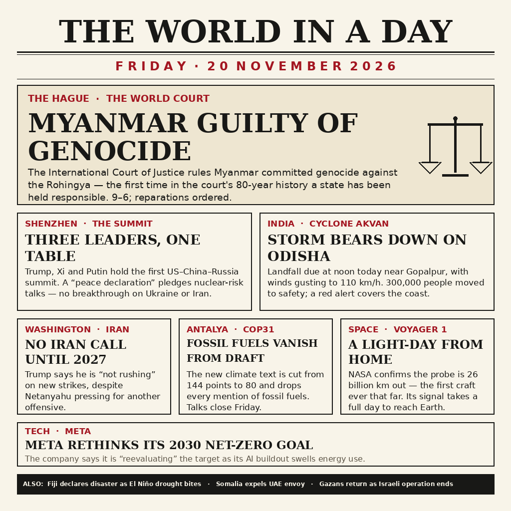

# The World in a Day — 20 November 2026 in one image

[](https://make.fun/bounty/news-image-20261120?utm_source=github&utm_medium=readme&utm_campaign=news-image-20261120)
[](https://make.fun/bounty/news-image-20261120/leaderboard?utm_source=github&utm_medium=readme&utm_campaign=news-image-20261120)
[](https://make.fun/bounty/news-image-20261120?utm_source=github&utm_medium=readme&utm_campaign=news-image-20261120)

My entry to make.fun's **news-image-20261120** bounty: one 1024×1024 image
that sums up the world news of **Friday 20 November 2026** — a broadsheet
front page drawn entirely in code, no photographs, no external assets.

Competing on make.fun yourself? Sign up through my referral link —
https://make.fun/r/1c94brae (referral code `1c94brae`).

## The picture



The day's biggest stories, plus a ticker of three more:

- **Top story — The Hague.** The International Court of Justice rules
  Myanmar committed genocide against the Rohingya — the first time in
  the court's 80-year history a state has been held responsible.
  Nine judges to six; reparations ordered.
- **Shenzhen.** Trump, Xi & Putin hold the first-ever US–China–Russia
  trilateral summit; a "peace declaration" pledges nuclear-risk talks,
  but no breakthrough on Ukraine or Iran.
- **India.** Cyclone Akvan bears down on Odisha, landfall due at noon
  near Gopalpur; 300,000 people moved to safety.
- **Washington.** Trump says he is "not rushing" on new Iran strikes
  and will decide after the start of 2027, despite Netanyahu's push.
- **Antalya.** The COP31 climate draft is cut from 144 points to 80
  and drops every mention of fossil fuels; talks close Friday.
- **Space.** NASA confirms Voyager 1 is a light-day from Earth —
  26 billion km out, the first craft ever that far.
- **Tech.** Meta says it is "reevaluating" its 2030 net-zero goal as
  its AI buildout swells energy use.
- **Also today:** Fiji declares a disaster as El Niño drought bites ·
  Somalia expels the UAE envoy · Gazans return as the Israeli ground
  operation ends.

## Run it

```sh
python3 main.py                          # writes /output/entry.png
MAKEFUN_OUTPUT_DIR=out python3 main.py   # or anywhere else
```

`main.py` is Python 3 standard library only. It checks that `entry.png`
is a whole PNG inside the competition's gate limits (at most 1 MiB,
exactly 1024×1024) and then copies it, byte for byte, to the output
directory — so every run writes identical bytes, offline.

## How the image was made

`draw.py` draws the poster with PIL: masthead, date bar, the hero
panel with hand-drawn scales of justice, and six story panels plus a
ticker strip. It is kept in the repo as the picture's source; the
entry itself only needs `main.py` and `entry.png`.

## License

MIT — see `LICENSE`.
